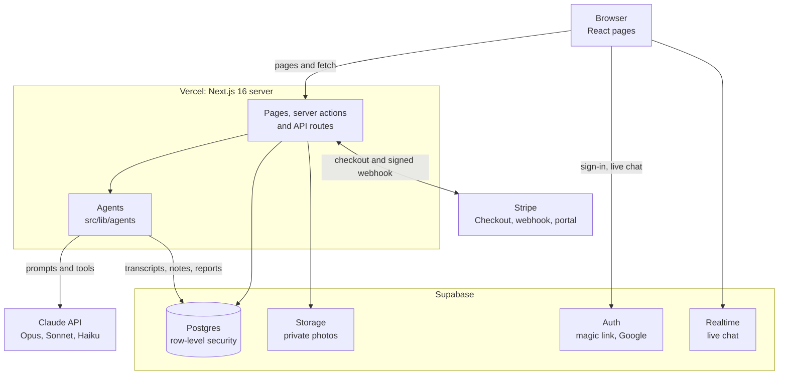
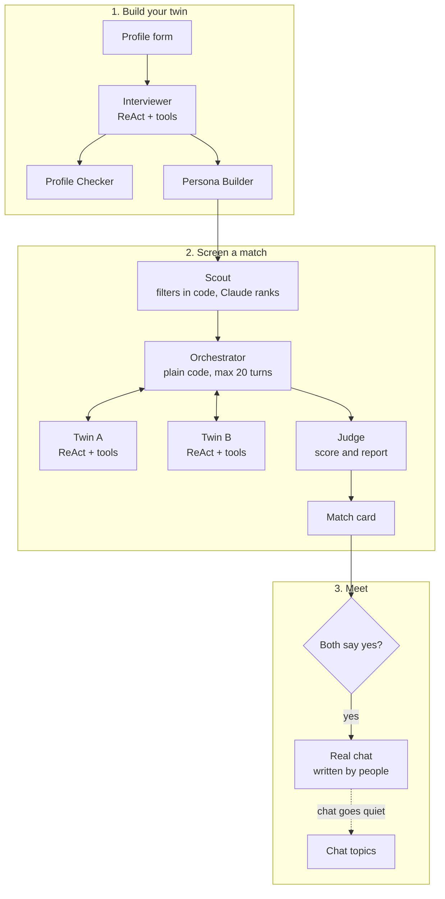

# Twin Date

**Your AI twin goes on the first chat for you, then hands you back the people worth meeting.**

Live at **https://twin-date.vercel.app** · [PRD](docs/PRD.md) · [Write-up](docs/WRITEUP.md) ([PDF](docs/Twin_Date_Writeup.pdf)) · Demo-day slides and script in [`docs/presentation`](docs/presentation)

On dating apps, the questions that decide a match (kids, money, where to live) come up last,
after weeks of small talk. Twin Date gives every user an AI twin built from their profile and
an onboarding interview. Twins have first chats with other users' twins, cover the big topics,
and stop at a dealbreaker. Each person gets a private report and decides whether to meet. Once
both say yes, the twins step back and every message after that is written by the people
themselves.

## How it works

1. **Profile.** Basics and multiple-choice answers on core topics. Each topic has a tier:
   *locked* (kids, religion, smoking, relocation, dealbreakers: the twin never guesses),
   *soft* (the twin may give a hedged guess) or *open* (the twin may improvise).
2. **Interview.** A short chat with the Interviewer agent fills gaps and captures how you
   text. The Profile Checker summarizes what the interview added and flags anything that
   contradicts your form, so you can reconcile it.
3. **Your twin.** The Persona Builder writes your twin's voice. You can talk to your twin to
   check that it sounds like you.
4. **Find my next match.** The Scout picks someone, and you can watch the two twins chat live.
5. **Report.** The Judge scores the chat and writes each person their own view: a headline,
   pros, cons, dealbreakers and things to ask in person. You answer Yes, Pass or a connection request. A Pass is never
   shown to the other person.
6. **Real chat.** On a mutual yes, names and photos unlock and a real-time chat opens, with the
   twins' conversation folded on top. If the chat goes quiet, you get topic suggestions taken
   from what the twins talked about.

## Architecture



API keys for Claude, Stripe and the Supabase secret key live only on the server. The browser
talks to Supabase directly only for sign-in and live chat, and row-level security limits what
it can read.

### Agent pipeline



## Agents

All agents run on Claude through the Anthropic TypeScript SDK, in
[`src/lib/agents`](src/lib/agents). Each agent uses the cheapest model that does its job
well: Opus 5.5 where quality matters most and calls are rare, Sonnet 5.5 for the chats,
and Haiku 5.5 for short summaries and extraction.

| Agent | What it does | How it works | Model |
|---|---|---|---|
| Interviewer | Fills profile gaps and gets the user talking | ReAct loop with tools: `get_profile_status`, `save_interview_fact`, `finish_interview` | Sonnet 5.5 |
| Interest parser | Turns typed interests into short items that can be matched | Structured output; falls back to splitting on commas | Haiku 5.5 |
| Profile Checker | Summarizes what the interview added, lists contradictions with the form | Structured output | Sonnet 5.5 |
| Persona Builder | Writes the twin's persona card and texting style | Structured output | Opus 5.5 |
| Scout | Picks the next match | Hard filters in code, then Claude ranks the remaining candidates | Sonnet 5.5 |
| Twin | Speaks as the user in first person | ReAct loop in twin-to-twin chats, with tools: `update_ledger` (private notes), `flag_red_flag`, `end_conversation` | Sonnet 5.5 |
| Orchestrator | Runs a twin-to-twin conversation | Plain code, not an LLM: alternates turns, caps the chat at 20 turns, stops on a red flag | (none) |
| Judge | Scores a finished chat (0-100) and writes a report for each person | Structured output; reads the transcript and both twins' private notes | Opus 5.5 |
| Match card | Turns a report into a one-line headline and tags | Structured output, cached per report | Haiku 5.5 |
| Chat topics | Suggests topics when a real chat goes quiet | Structured output, based on the twins' first chat | Haiku 5.5 |

The twin and interview chats use prompt caching: their long system prompts (and, for the
interview, the chat so far) are re-sent every turn, and cached tokens cost a fraction of the
normal price.

Agents prepare; people decide. No agent says yes or sends a message on a real person's behalf.

## Guardrails

Rules that must hold are enforced in code, not only in prompts:

- A twin can flag a red flag only on one of its own locked answers; otherwise the tool refuses.
- A twin can't end a chat before turn 6, and the Orchestrator ends every chat at 20 turns.
- A chat that ended on a dealbreaker can't score above 20.
- Twins never see names, contact details or photos. They talk as "Member A" and "Member B".
- The interview can't finish until the user has sent at least 6 messages, so the twin has
  enough of their writing to copy their voice.
- Each turn is saved before the next one starts, so a chat resumes where it left off after
  a failure. Users see a readable error with a Retry button. A request that Opus or Sonnet
  declines is retried on a fallback model; Haiku has no fallback, so its features (match card,
  chat topics, interest parsing) degrade to a plain version instead.

## Security and privacy

- Row-level security on every table: users read only their own data and the chats they are
  part of. Twins' private notes have no browser access at all.
- API keys (Anthropic, Supabase secret, Stripe) stay on the server.
- Photos are in a private storage bucket and are shown only through short-lived signed links
  after a mutual yes.
- Only a signed Stripe webhook can change a user's plan.

## Plans and payments

Plans are priced by how many twin chats you get per week. The quota is enforced on the
server when you press "Find my next match".

| Plan | Price | Twin chats per week |
|---|---|---|
| Free | $0 | 3 |
| Plus | $9.99 / month | 15 |
| Pro | $24.99 / month | 40 |

Payments use Stripe Checkout in test mode (card `4242 4242 4242 4242`, any future date, any
CVC). Paying users can switch between Plus and Pro with prorated billing, and cancel in
Stripe's customer portal.

## Course requirements

| Requirement | Where |
|---|---|
| React | Next.js 16 App Router with React 19 (`src/app`) |
| Multiple agents, including ReAct | 9 Claude agents plus the Orchestrator; Interviewer and Twin use a ReAct tool loop (`src/lib/agents`) |
| Authentication | Supabase Auth with email magic link and Google (`src/app/login`, `src/app/auth`, `src/proxy.ts`) |
| Payments | Stripe Checkout, webhook and customer portal (`src/app/api/stripe`, `src/lib/billing.ts`, `/pricing`) |
| Publicly deployed | Vercel: https://twin-date.vercel.app |

## Tech stack

- **Frontend and server:** Next.js 16 (App Router, Cache Components), React 19, TypeScript,
  Tailwind CSS v4
- **Data:** Supabase Postgres, Auth, Storage (photos) and Realtime (chat)
- **AI:** Claude (Opus 5.5, Sonnet 5.5, Haiku 5.5) via `@anthropic-ai/sdk`, with Zod for tool inputs
  and structured outputs, and prompt caching for the chats
- **Payments:** Stripe (test mode)
- **Hosting:** Vercel

## Run it locally

Requirements: Node.js 20+, a Supabase project, an Anthropic API key, and a Stripe account in
test mode.

1. Install dependencies:
   ```bash
   npm install
   cp .env.example .env.local
   ```
2. Fill in `.env.local`. Each variable is explained in [`.env.example`](.env.example):
   `NEXT_PUBLIC_SUPABASE_URL`, `NEXT_PUBLIC_SUPABASE_PUBLISHABLE_KEY`, `SUPABASE_SECRET_KEY`,
   `ANTHROPIC_API_KEY`, `STRIPE_SECRET_KEY`, `STRIPE_WEBHOOK_SECRET`.
3. Set up the database: in the Supabase dashboard (SQL Editor), run every file in
   [`supabase/migrations`](supabase/migrations) in order, `0001` to `0016`.
4. Start the app:
   ```bash
   npm run dev    # http://localhost:3000
   ```
5. Optional, for payments: forward Stripe events with
   `stripe listen --forward-to localhost:3000/api/stripe/webhook` and use the signing secret
   it prints as `STRIPE_WEBHOOK_SECRET`.

### Scripts

The scripts use `.env.local` and the server-side admin client.

| Command | What it does |
|---|---|
| `npm run seed -- --cities "Los Angeles"` | Creates 40 synthetic users in 20 planted test pairs (10 with a dealbreaker conflict, 10 compatible). `--dry-run` only generates them; `--reset` replaces existing ones. |
| `npm run converse -- --pair 1` | Runs one twin-to-twin conversation and prints it, then the Judge's report. Also accepts two emails or user IDs. `--list-pairs` lists the test pairs. |
| `npm run judge -- <conversationId>` | Writes or rewrites the Judge's report. `--all` judges every finished chat without a report. |
| `npm run check-matches -- <email>` | Shows how many candidates are left after each of the Scout's filters, to explain why someone gets no matches. |
| `npm run build` / `npm run lint` | Production build and lint. |

## Project structure

```
src/
  app/               Pages and API routes
    onboarding/      Profile form and interview
    twin/            Talk to your twin
    matches/         Match feed, live twin chat, report and Yes/Pass
    connections/     Inbox of mutual matches
    chat/            Real-time chat between people
    pricing/         Plans and Stripe checkout
    api/             Interview, persona, matching, conversation steps, Stripe
  lib/
    agents/          The Claude agents and the Orchestrator
    supabase/        Browser, server and admin clients
  components/        Shared UI
supabase/migrations/ Database schema, row-level security and storage, in order
scripts/             Seed users, run and judge conversations, debug matching
docs/                PRD, project write-up (Markdown and PDF)
docs/presentation/   Demo-day slides and speaker script
```

[`CLAUDE.md`](CLAUDE.md) has the coding conventions we followed (also read by Claude Code).

## Team

Chengrui Hao, Yuming Gao, Shihan Wang, Charlotte Zhu
