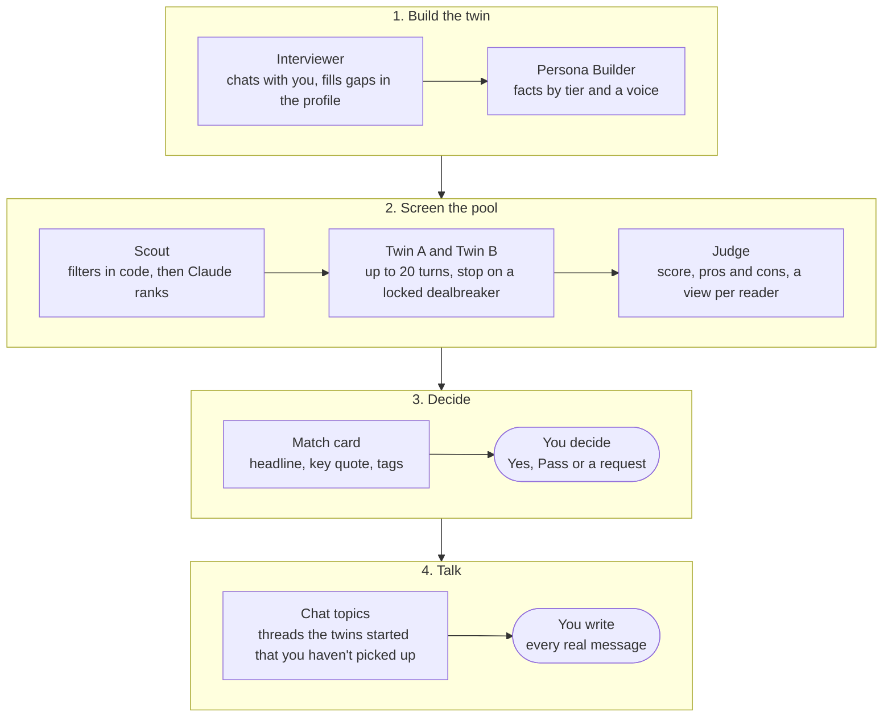

# Twin Date — Product Requirements Document

Oct 20, 2026 · Shihan Wang

## Overview

Twin Date gives each user an AI twin that has the awkward first chat with other users' twins, then hands back a short, private report so the user decides who to meet. It is a public web app built by a team of 4 for the Oct 22, 2026 demo.

**Problem.** On dating apps, the questions that decide a match (kids, money, moving, relationship type) come out late, after hours of small talk, or never. Once two people do match, chats stall because nobody remembers what to pick up.

**What Twin Date does.**

- Before matching: twins screen for dealbreakers and fit, so people only meet matches worth their time.
- After matching: the app hands the people what their twins learned (the twins' chat, a one-line takeaway, topics the twins started) and then gets out of the way. The real chat is written only by the people.

**Goals for the demo.** A user can build a twin, let it screen matches, decide privately on each report, and chat with the people they match, on a live site with sign-in, AI agents and paid plans.

## Users and core flow

The user is an adult (18+) tired of swiping and small talk who is happy to let an AI do the first round. The demo pool adds about 40 synthetic seed members, labeled "Demo profile".

1. Sign in with Google or an email link and confirm 18+.
2. Fill in the profile (basics, preferences, tiered topics) and add up to 6 photos.
3. Do the onboarding interview with the Interviewer agent; the Persona Builder turns it into the twin.
4. Talk to your twin to check it sounds like you.
5. Pick a plan (Free 3, Plus 15, Pro 40 twin chats a week).
6. Find a match: the Scout filters and ranks, then the two twins chat while the match page is open.
7. Read the report, written to you. Decide at the bottom: Yes, Pass, or after a dealbreaker Connect anyway.
8. Both want to meet: names, ages, cities and photos appear, and the match moves to Connections.
9. Chat in person-to-person messages, with the twins' first chat folded above. After 2 quiet days, the app offers something the twins talked about that you haven't.
10. No mutual yes within 7 days: the match quietly moves to Expired for whoever said yes.

## Functional requirements

All requirements below are in scope for the Oct 22 demo. Items planned for later are listed under "Scope and roadmap".

### Profile and onboarding

- Profile form: basics, location, age range, gender preference, relationship goal, and tiered topics (locked facts the twin never guesses, soft facts it may hedge, open facts it may improvise).
- Onboarding interview with the Interviewer agent; the Persona Builder turns form and interview into the twin.
- "Talk to your twin" to check it sounds like you.
- Photos: up to 6 (JPEG, PNG, WebP, 5 MB each) at the top of the profile page; the first is the main photo.
- Profile hero card: main photo, name, age, city, goal, photo count and twin status.

### Matching and twin chats

- Scout: hard filters (gender both ways, both age ranges, goal, city, has a twin, not met before), then Claude ranks.
- Twin-to-twin chat: up to 20 turns, one turn per request while the match page is open; a red flag ends it early.
- The weekly quota per plan limits how many matches you can find.

### Reports and match cards

- Judge: score 0-100 (capped at 20 after a dealbreaker), a per-reader view with headline, pros and cons, verified quotes, questions to ask.
- Match card agent: a headline of 8-16 words, each person's most telling quote with its topic and key words highlighted, and 2-4 tags (aligned, ask, dealbreaker). Written once per report and cached.

### Decisions

- Decide only on the report page, pinned at the bottom while you read.
- Yes and Pass are private; a connection request is shown to the other side, who can Accept.
- Connected = both sides chose yes or request; decisions then lock.
- A yes not returned within 7 days of the twins' chat moves to Expired ("This one didn't turn into a match").
- Passed matches sit in a private Passed group with Send request and Hide; Hide keeps the data.
- Seed members answer automatically: yes when the score is 60 or more and there was no red flag.

### Connections and chat

- Inbox: a row of new matches not yet messaged, then chats sorted by latest message with a preview, time, unread dot and "Known N days".
- Chat: realtime messages, read receipts (Seen), hearts (double-click), typing indicator, emoji picker, photos (JPEG, PNG, WebP, GIF, 8 MB), day separators and send times.
- The twins' first chat sits folded at the top, then a "You matched" divider.
- Starters: the report's questions to ask, until the chat has 6 messages.
- Quiet nudge: after 2 days with no message, one thread the twins started that the people haven't picked up, with a line ready to send. It only fills the message box. No suitable thread, no nudge.

### Payments

- Stripe Checkout in test mode (test cards only): Free $0 (3 twin chats a week), Plus $9.99 a month (15), Pro $24.99 a month (40). The weekly quota applies when finding a new match.
- Switch plans: paying users move between Plus and Pro on /pricing. Stripe prorates by the time left in the billing period: an upgrade charges the difference now, a downgrade leaves a credit on the next invoice. Switching also undoes a pending cancellation.
- Cancel or update the card in Stripe's billing portal. A cancelled plan stays active until its period ends, then the user is back on Free; /pricing shows the end date.
- Only Stripe sets a user's plan: a signature-checked webhook writes it, and /pricing re-checks the plan with Stripe.

## Agent architecture

Seven agents do the preparation and people make every choice: deciding on the report page and writing every real message.

Rounded boxes are people; the others are AI agents. A plain-code orchestrator, not an LLM, runs the twins' turns and enforces the rules.

Design rules:

- Each agent runs on Claude with tool use; the twins and the Interviewer run a ReAct loop (reason, call a tool, observe, repeat).
- Rules that must hold live in tool code and the database, not only in prompts: red flags only on a locked topic, the score capped at 20 after a dealbreaker, quotes checked against the transcript.
- A plain-code orchestrator, not an LLM, takes the turns, enforces the 20-turn cap and stops on a red flag.
- Isolation: each twin sees only its own facts, its own private notes and the transcript, never names or contact details.
- The Match card and Chat topics agents read only what both people can see (the report, the twins' chat, the real chat), never the twins' private notes, and cache what they write.
- Model: claude-opus-5-5 with effort low for chat and medium for the Persona Builder. Plan quotas should keep model cost under about 30% of each plan's price.

## Privacy, safety and consent

Each rule is enforced in the database or server code, not only in prompts.

| What | Who can see it | How it's enforced |
| --- | --- | --- |
| Your yes or pass | Only you, never the other side | Row-level security plus decision\_states(), which reports only connected and requests |
| A connection request | You and the other person | Shown on purpose so they can accept |
| Why a yes expired | Nobody | Expired never says whether they passed or didn't answer |
| Name, photos, city | The other person, only after a mutual yes | Private buckets, signed URLs valid for 1 hour, admin reads only after the connected check |
| Twins' private ledgers | Server only, never shown | No browser access; the match card and chat topics agents don't read them |
| Chat messages and chat photos | The two connected people | is\_connected() on chat\_messages; chat\_folder\_ok() on the chat-photos bucket |
| Hidden passed matches | Only you | hidden\_matches, own rows only |
| Your messages in the chat | Written only by you | AI only suggests (starters, quiet nudge) and fills the box; it never sends |
| Twins' words in the chat | Both people, labeled | Folded, grey, marked "Your twin" and "Their twin" |

Also: sign-up requires a birthdate of 18 or older; every twin message is labeled as AI; and API keys stay on the server.

## Data model

Data lives in Supabase Postgres with row-level security on every table, plus two private Storage buckets. users comes from Supabase Auth; every other table references it.

| Table or store | Holds | Who can read it |
| --- | --- | --- |
| profiles | Basics, preferences, city, goal, photo paths, seed flag | The owner; others' name, age, city and photos only through the server after a mutual yes |
| profile\_answers | One answer per topic with its tier | The owner and server code |
| interview\_messages | The onboarding chat | The owner |
| persona\_cards | The twin's facts and voice, versioned | The owner and server code |
| conversations | Twin-to-twin chats: status, turns, end reason | Both participants |
| messages | The twins' transcript | Both participants |
| ledgers | Each twin's private notes | Server only |
| reports | Score, per-reader views, quotes, questions, the cached match card | Both participants |
| decisions | Yes, pass or request per person | Your own; the other side's only as a request; connected via decision\_states() |
| hidden\_matches | Passed matches you hid | Only you |
| chat\_messages | Real messages and photo paths | The two connected people |
| chat\_reads | When each person last read a chat (unread, Seen) | Your own; the other's read time via chat\_other\_read\_at() |
| chat\_reactions | Hearts on messages | The two connected people |
| chat\_topics | Cached quiet-chat topics | Server only |
| subscriptions | Plan, Stripe customer, period end, weekly use | The owner; written by the Stripe webhook |
| photos bucket | Profile photos, one folder per user | The owner; others through signed URLs after a mutual yes |
| chat-photos bucket | Photos sent in chats, one folder per chat | The two connected people |

## Navigation and design system

A header on every page is the only navigation; pages don't repeat it with their own buttons.

| Screen | What it shows |
| --- | --- |
| Header | Twin Date; Connections (first) and Matches with count badges; your avatar and name, opening a menu (profile and photos, your twin, Matches, Connections, plans and billing, sign out) |
| Home | The slogan as the headline. Before onboarding: the next setup step. After: a Matches card and a Connections card |
| Matches | Grid like Hinge's "Likes you": To review tiles (percentage ring, Member B and age, city and goal, one line, tags, red dot), Matched tiles opening the chat, collapsed Waiting, Passed and Expired |
| Report | The per-reader report, the twins' chat, and the Yes / Pass bar |
| Connections | Inbox like Instagram DMs: new matches row, then chats with preview, time, unread dot, "Known N days" |
| Chat | One chat card: back arrow, photo, name, "Matched N days ago", Twins' report button; the twins' chat folded on top; messages; composer with emoji, photo and send |
| Profile | Hero card, photos, the form with a pinned Save |
| Plans | Free, Plus and Pro with the current plan; upgrade through Stripe Checkout, switch between Plus and Pro, or open the billing portal to cancel |

Shared styles live in src/lib/ui.ts. Colors are mostly black, white and grey, and each color has one meaning:

| Color | Means |
| --- | --- |
| Pink | Liking: the Yes heart and hearts on messages |
| Light purple | Your own messages in the real chat |
| Violet | Something the AI twins found or wrote |
| Blue | Unread chats |
| Red | Something needs you (badges), and dealbreakers |

## Scope and roadmap

The demo ships the requirements above; the items below are deliberately left out or planned for after Oct 22.

**Out of scope, by design**

| Not doing | Why |
| --- | --- |
| An AI twin sending messages in the real chat | The real chat is written only by the people |
| A "Ready to meet" button | People can suggest meeting themselves |
| Deciding from the Matches list | You decide after reading the report, in one place |
| Tasks, scores or streaks in the inbox | A conversation isn't a task, and the score matters less once people really talk |
| Native mobile apps, chat-history import, production-grade moderation | Beyond a one-week build |

**Planned next**

- Ask my human: the twin asks you a question it can't answer, and your answer joins its facts
- Jump in: you write your twin's next message during a twin chat
- Twin fidelity rating and corrections on Talk to your twin
- A switch to pause screening
- Delete my data
- Report and block, and unmatch

**Open questions**

- Should the twin appear as a character in the app?
- Final visual palette: the current black-and-white base, or a warmer light-pink one.

## Success metrics

The demo has to show that twins are faithful, critical rather than agreeable, and affordable; the checks run on the seeded pool.

| Metric | How it's measured | Target |
| --- | --- | --- |
| Twin fidelity | Each team member rates their own twin "sounds like me" | Average 4/5 or higher |
| Red-flag recall | 10 seeded pairs with a planted dealbreaker conflict | 9/10 or more end early with the right red flag |
| False alarms | 10 seeded pairs that fit by design | 1/10 or fewer flagged |
| Judge consistency | The Judge re-run 3 times on one transcript | Score spread of 10 points or less |
| Cost and latency | Tokens and time logged per conversation | A measured number that sets the plan quotas |

## Future improvements

- Learn from outcomes: whether people who met rated the date well, fed back into ranking.
- Anti-gaming: detecting profiles tuned to impress the twin rather than be accurate.
- Push notifications for new messages, requests and quiet-chat topics.
- Native mobile apps.
