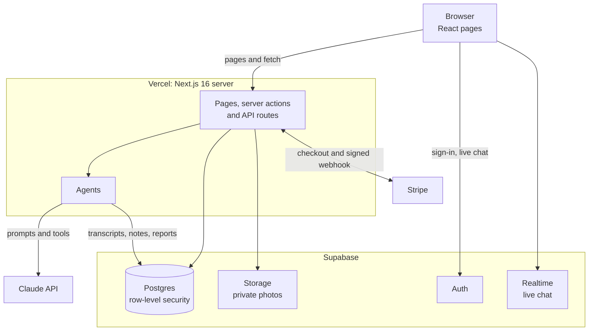

# Twin Date

**Your AI twin goes on the first chat for you, then hands you back the people worth meeting.**

Project write-up · Oct 21, 2026
Chengrui Hao · Yuming Gao · Shihan Wang · Charlotte Zhu
Live: https://twin-date.vercel.app · Code: https://github.com/MichaelHcr/Twin_Date

---

## 1. Problem

On dating apps, the questions that decide whether two people fit (do you want kids, how do you handle money, would you move, what are you looking for) come up late, after hours of small talk, or never. Filters like age and distance can't tell you how someone talks or what they would compromise on. And once two people do match, the chat often stalls because nobody remembers what to pick up.

Our user is an adult who wants something serious, is tired of swiping and small talk, and is happy to let an AI do the first round.

## 2. Solution

Twin Date gives every user an **AI twin**, built from a profile form and a short interview. Twins have first chats with other users' twins, cover the big topics, and stop at a dealbreaker. Each person then gets a private report and decides on their own whether to meet. When both say yes, names and photos unlock and the twins step back: every message in the real chat is written by the people themselves.

We think AI is the right tool here because a first chat is open-ended. It needs follow-up questions, judgment about what matters, and the ability to notice a conflict that no fixed filter would catch. At the same time, the important decisions stay with people: agents prepare, people decide.

## 3. Scoped PRD

We wrote the PRD before building and kept it as the source of truth, revising it as the product changed (v3 at the time of writing). The core flow it fixes:

1. Sign up (Google or email link) and confirm 18+.
2. Fill in a multiple-choice profile with tiered topics and up to 6 photos.
3. Do a short interview; review what it added and any contradictions with the form.
4. Talk to your twin to check it sounds like you.
5. Find a match: the Scout picks someone and the two twins chat while you watch.
6. Read the report written to you, then choose Yes or Pass in private.
7. On a mutual yes, chat for real, with the twins' first chat folded above.

The key product idea is the **improvisation tier** on every profile topic. *Locked* facts (kids, religion, smoking, drinking, drugs, relocation, dealbreakers) are never guessed: a twin that doesn't know says it would have to ask the real person. *Soft* facts (pets, money, weekends, politics) allow a hedged guess, and *open* facts (interests) allow improvisation. This is what lets a twin be useful without inventing the things that matter most.

### Scope decisions

| Decision | Why |
|---|---|
| No AI messages in the real chat | Once two people match, every message is theirs. AI may only suggest a line and fill the box. |
| Decide only on the report page | You decide after reading the report, in one place, never from a list of faces. |
| Yes and Pass are private | A pass is never shown; an expired match never says whether the other side passed or didn't answer. |
| AI never edits the profile | The form is the user's own word. Contradictions from the interview are shown for review instead. |
| Deferred | "Ask my human", jumping into a twin chat, fidelity ratings, background jobs, delete-my-data, block and report, native apps. |

### Success metrics

The demo has to show that twins are faithful, critical rather than agreeable, and affordable. The PRD sets targets on a seeded pool of 40 synthetic members, built as 20 planted pairs:

- **Twin fidelity:** each team member rates their own twin "sounds like me", averaging 4/5 or higher.
- **Red-flag recall:** at least 9 of the 10 pairs with a planted dealbreaker end early with the right red flag.
- **False alarms:** at most 1 of the 10 compatible pairs is flagged.
- **Judge consistency:** the same transcript judged 3 times varies by 10 points or less.
- **Cost and latency:** logged per conversation, used to set the plan quotas.

## 4. Architecture

Twin Date is a Next.js 16 app on Vercel. Supabase provides sign-in, Postgres with row-level security, private photo storage and realtime chat. Claude powers the agents, and Stripe handles payments. API keys never leave the server.

*Figure 1. System architecture.*

### Eight agents and one orchestrator

| Agent | Job | How it works |
|---|---|---|
| Interviewer | Fills profile gaps and gets the user talking | ReAct loop with tools to read the profile, save facts and finish |
| Profile Checker | Summarizes what the interview added; lists contradictions with the form | Structured output |
| Persona Builder | Writes the twin's voice and summary | Structured output |
| Scout | Picks the next match | Hard filters in code, then Claude ranks |
| Twin | Speaks as the user on a first chat | ReAct loop with private notes, red-flag and end-chat tools |
| Judge | Scores the chat 0-100 and writes each reader's report | Structured output |
| Match card | One-line headline and tags for the Matches grid | Structured output, cached |
| Chat topics | Suggests a twins' thread when a real chat goes quiet | Structured output, cached |

The **Orchestrator** is deliberately plain code, not an LLM. It alternates the two twins' turns, caps a chat at 20 turns, and stops when a twin raises a red flag.

### Design rules

- **Rules live in code, not only in prompts.** A twin can raise a red flag only on one of its own locked answers; the tool refuses otherwise. It can't end a chat before turn 6. A chat that ended on a dealbreaker can't score above 20. The interview can't finish before the user has written 6 messages.
- **Isolation.** Each twin sees only its own facts, its own private notes and the shared transcript. Twins talk as "Member A" and "Member B" and never see names, contact details or photos.
- **Facts come from the user.** Twins read facts from the profile form and interview facts, never from the AI-written persona card, so locked facts always come from the person.
- **One turn per request.** A 20-turn chat takes minutes, longer than a web request may run. The match page drives the chat one turn per request and all state lives in the database, so a closed page simply resumes later.

## 5. Implementation

**5** days · **20** pull requests · **85** commits · **16** database migrations · **~7,300** lines of TypeScript

| Day | What we shipped |
|---|---|
| Oct 17 | Repo, Vercel deploy, Supabase schema with row-level security on every table, sign-in with email link and Google. |
| Oct 18 | Profile form, Interviewer, Persona Builder and "Talk to your twin". Then the core loop: seed users, the Orchestrator and twin tools, the Judge and match pages, and the Scout with live twin chats in the browser. First end-to-end run: real user, twin chat, report. |
| Oct 19 | Yes, Pass and connection requests with privacy enforced in the database; realtime chat with photos and read receipts; Stripe plans; agent quality fixes. |
| Oct 20 | Reports written to each reader, Hinge-style match grid, plan switching, multiple-choice profile with the Profile Checker, demo slides and README. |
| Oct 21 | Separate sign-in and sign-up, final polish. |

We worked in feature branches, each built and checked on a Vercel preview before a pull request was merged into `main`. Claude Code helped write much of the code; every change was reviewed, built and run by a team member before merging.

### How we tested

A seed script asks Claude to design 20 pairs of synthetic users, 10 with a planted dealbreaker conflict and 10 compatible by design, and saves which is which. Scripts run a twin chat between any two users, re-run the Judge, and explain why someone gets no matches by applying the Scout's filters one at a time. The agent logic (turn order, tool refusals, score caps, hard filters) was also checked against a mock Claude server and a fake database before running against the real ones.

### What we learned

- **Prompts are not rules.** Anything that must hold had to move into tool code or the database. Early twins were too agreeable and rarely asked questions back; a rule in the prompt alone was not enough.
- **Synthetic data needs constraints in code.** Left alone, separate Claude calls produced seven seed users named Marisol, all in their thirties, so a 24-year-old tester matched no one. We now assign names, ages and jobs in code and let Claude write the rest.
- **Small data mismatches break matching.** "Los Angeles, CA" and "Los Angeles" were different cities until we normalized them. A diagnostic script that shows how many candidates survive each filter found both problems in minutes.
- **Privacy is a product choice that shapes the schema.** Keeping a Pass private meant users could read only their own decision, so a database function reports who is connected without exposing anyone's answer.

## 6. Deployment

- **Hosting:** Vercel deploys `main` to https://twin-date.vercel.app; every branch gets a protected preview.
- **Secrets:** the Claude, Stripe and Supabase secret keys are server-only environment variables in Vercel, never sent to the browser.
- **Database:** 16 numbered SQL migrations create the tables, row-level security policies, storage buckets and realtime publication. Photos are shown only through short-lived signed links after a mutual yes.
- **Payments:** Stripe Checkout in test mode with three plans by weekly twin chats: Free (3), Plus at $9.99 a month (15) and Pro at $24.99 a month (40). Only a signature-checked webhook can change a user's plan; paying users can switch plans with prorated billing and cancel in Stripe's portal.
- **Reliability:** agent errors become readable messages with a Retry button, a request the model declines falls back to another model, and every twin turn is saved before the next one starts.

## 7. Next steps

- **Measure the success metrics** on the 20 planted pairs: red-flag recall, false alarms, Judge consistency and cost per chat, then set the plan quotas from real numbers.
- **Ask my human:** when a twin hits a question it can't answer, it asks the user, and the answer joins its facts.
- **Jump in** during a twin chat, and rate and correct your twin's replies on "Talk to your twin".
- **Background jobs**, so twin chats run without the match page open.
- **Safety basics:** delete my data, report and block, unmatch, and a switch to pause screening.
- **Learn from outcomes:** feed back whether people who met enjoyed the date into ranking.

> The twins do the screening; the decisions and the real conversation stay human.
